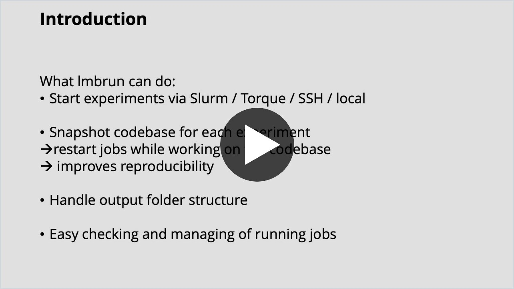
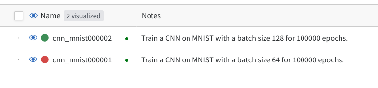

# lmbrun
lmbrun is a tool to run code on computers (locally, via ssh, via SLURM, via Torque).

## Overview
What lmbrun can do:
* start experiments via Slurm, Torque, SSH, or locally on the current machine,
* snapshot the current codebase in form of a git tag and reuse this snapshot when running the code (helpful for reproducibility and for working on the codebase without affecting the experiment even in case its job restarts),
* give experiments an ID and create an output folder in a structured format,
* handle cluster-specific stuff and deal with clusters with a walltime via job-chains,
* provide tools to check the current status of jobs and to continue jobs,
* provide tools to continue experiments seamlessly on a local machine / an ssh machine / a SLURM node / a Torque cluster node.

For more details, see the following video:

[](https://pschroeppel.github.io/data/lmbrun-demo.mp4)

## Getting started
 
The following guides you through an example to get you started. It assumes that you cloned lmbrun to `/path/to/lmbrun`.

### Set user specific default config values for lmbrun:
```bash
cd /path/to/lmbrun/lib
cp _user_conf.yaml user_conf.yaml
```
This is required because the file user_conf.yaml is on the .gitignore so that you won't push your user specific 
values to the repository.

Then edit user_conf.yaml with your favorite text editor. For now its sufficient to change `output_base_path`, 
`user_name` (you can already set everyhing else according to your needs, so you won't forget to do it later).

### Set system specific config values (required for SLURM and Torque):
To run code via SLURM or Torque, lmbrun needs to know some values that are specific to your cluster (e.g. the host that 
is used to submit jobs, or the available partitions):
```bash
cd /path/to/lmbrun/lib
cp _system_conf.yaml system_conf.yaml
```
Like user_conf.yaml, the file system_conf.yaml is on the .gitignore.

Then edit system_conf.yaml and fill in the section for your cluster types (`slurm` and/or `torque`).

For SLURM:
- `login_host`: the host to submit SLURM jobs
- `partitions`: the partitions that you want to use. On the cluster, `sinfo -o "%P"` lists all partitions.
- `gres`: additional generic resources besides gpus that you want to request via `additional_gres`, e.g. `localtmp`. 
  On the cluster, `sinfo -o "%G"` lists the available generic resources.
- `gpu_types`: the gpu types that you want to request via `gpu_type`. These are the names in the gpu entries of 
  `sinfo -o "%G"`, e.g. `l40s` for `gpu:l40s:8`. Leave empty if you don't need to request specific gpu types.

Example config for SLURM:
```yaml
slurm:
  login_host: slurmheadnode
  partitions:
    - gpu-h200
    - gpu1
  gres: []
  gpu_types: []
```
 
### Create some dummy project somewhere:
For example create `~/playground/dummy_project/dummy_run.py` with contents:
```python
import sys   
import time
import signal
import datetime
import time

def signal_handler(signum, _):
    print("{0} - Received signal {1}.".format(datetime.datetime.now(), signum))
    print("Sleeping for 5 seconds.")
    time.sleep(5)
    print("Exit.")
    exit(1)

signal.signal(signal.SIGINT, signal_handler)
signal.signal(signal.SIGUSR1, signal_handler)
signal.signal(signal.SIGTERM, signal_handler)

print("Running dummy run with parameters:")
print(sys.argv)
time.sleep(15)
print("Finishing dummy run")
```

### Initialize a git repository:
lmbrun depends on your code being in a git repository. Therefore, initialize a git repository for your dummy project:
```bash
cd ~/playground/dummy_project
git init ; git add -A ; git commit -m "initial commit"
```

When you run code, a new git tag will be created and the actual run will checkout this tag (in a temporary directory) before execution. 

### Run your dummy project code with lmbrun
The most handy way to run code with lmbrun, is by using a config file that contains the information required for running your code. 

A sample config file for running the dummy project is provided at `sample.yaml`. First you have to adapt the file to your setup. In particular, you have to set `git_path` to the path of the `dummy_project` repository.

Then, to run the code `dummy_project` code, do:
```bash
cd /path/to/lmbrun
lmbrun sample.yaml
```

You can also add `/path/to/lmbrun` to your `PATH`, e.g. `export PATH="$HOME/workspace/lmbrun:$PATH"`. You can also do this permanently via your `bashrc`. Then you can run `lmbrun` from anywhere.

If you want to check/change which run parameters are actually used, do:
```bash
cd /path/to/lmbrun
lmbrun sample.yaml --prompt
```

You are asked to enter appropriate parameters for the run via prompts. As default values, the prompts use the values from the config file. Note that some of the prompts provide autocomplete (e.g. paths, the target, etc.). 

#### Optional: Run code from the command line
Alternatively, you can also run your code directly from the command line, without using a config file. For example, to run the dummy project code, do:

```bash
cd ~/playground/dummy_project
/path/to/lmbrun/lmbrun python3 dummy_run.py --some_sample_parameter
```

You are asked to enter appropriate parameters for the run via prompts. As default values, the prompts use the values that you filled in before in your `user_conf.yaml` file. If you filled out your `user_conf.yaml` properly, you probably don't have to enter anything for the prompts, but just always press enter.

---

### Check the status of your runs
To check the status of your runs, go to the directory of one of your runs ( e.g. `base_path/test/t_dummy_project000001/t_dummy_project000001/` ) and try
- `path/to/lmbrun/lmbstat`
- `path/to/lmbrun/lmbcont`
- `path/to/lmbrun/lmbkill`

You can get information about more options of `lmbrun/lmbcont/lmbstat/lmbkill` by using `-h`.

## What happens under the hood when running code with lmbrun
When running code with lmbrun, the following happens:
- First, a `RunConfig` is initialized for your run. It contains all information that is required for your run (the base output directory, the commands to be executed, the target compute node/cluster, etc.). The initialization is done either based on a config file, and/or prompts that you answer.
- A new output directory is created within the base output directory (`output_base_path`) that you specified in the config or via the prompts. This output directory is named according to the run id (e.g. `dummy_project000001`).
- A new git tag is created within the repository of your code. This git tag serves as a snapshot of your codebase for the particular experiment. When the code is executed, the codebase is checked out at this tag. The git tag contains your repository in its current state including uncommited changes and untracked files (but it does not contain files on the `.gitignore`). The git tag is named like: `lmbrun_outputbasefoldername_runid` (e.g. `lmbrun_dummyexperiments_dummy_project000001`).
- Scripts to execute the code are created and placed within the output directory (in a subfolder called `jobs`). 
- The scripts are then executed on the target compute node/cluster. For example they are submitted to the cluster via SLURM or executed directly on your local machine or executed on some other machine via ssh.
- What the scripts do is: they create a new temporary folder and check out the git tag. Then they execute the commands that you specified. 

## Additional information

### Placeholders
You can pass the output directory of your run to the code, by using the special placeholder `%LOGDIR%`. For example creating a run with 
run parameters `python your/python/code.py train with model_dir=%LOGDIR% augmentation=False` will pass
parameters as follows to your python program: 
```bash
python your/python/code.py train with model_dir=/tmp/some_model_dir000001 augmentation=False
 ```

Because your code is executed from a temporary directory, it usually makes sense to pass the output directory to your code.

Other placeholders that you can use are:
- `%COMMENT%` : the comment that you entered when running the code
- `%RUNID%` : the run id of the current run
- `%SEED%` : the seed of the current run (lmbrun can take care of this and increment the seed for each new job in a job chain; for example to prevent that with each new job a diffusion model is presented the same noise patterns as in previous jobs)

 ## Warning

> **⚠️ WARNING ⚠️**
> 
> **lmbrun will make changes to the git repository of your code.**
>
> **If you are new to lmbrun, make sure to commit and push an up-to-date version of your code before using lmbrun for the first time!**


The main thing that can go wrong is: lmbrun creates a new git tag for the current state of the codebase. If lmbrun
is aborted while doing this, the codebase will be in an invalid state.

For this reason, the recommendation is: do not abort lmbrun while it starts jobs.

However, if this happens, you can see that the codebase is in an invalid
state because:
- the codebase will be on a branch called `tmp_create_tag`
- the stash will contain current changes (see `git stash list`)


To resolve this, go to the codebase root directory and do:
```bash
git checkout PREVIOUS_BRANCH  # (e.g. master)
git stash pop || true
git branch -D tmp_create_tag
```

---

## FAQ
**Which file in my git repository are included in the snapshot that lmbrun creates for each experiment?**

All files not on the `.gitnore`, including all uncommited files, are included in the snapshot. Note that it makes sense to make sure that big files (weights, data, ..) are on the the `.gitignore`.


**My code expects certain big files to be available in the repository root folder (e.g. certain pretrained weights, or datasets). As `lmbrun` clones the code to a new temporary folder, excluding files on the `.gitignore`, those files are missing. How to deal with this?**

Create links to those files by putting respective commands into the `pre_commands` of `lmbrun`, e.g. `ln -s /path/to/repository/data .`

**My code writes its outputs to a folder within the repository (for example called `outputs`). As `lmbrun` executes code from a temporary folder, the output is lost. How to deal with that?**

Create links via the `pre_commands` to shift the outputs to the output folder that `lmbrun` created, e.g. `ln -s %LOGDIR% outputs`.

**Everytime I run code with `lmbrun` via SLURM, I have to enter a password. How to avoid this?**

Set up key-based authentication for ssh, so that you can login without a password.

**`lmbrun` sometimes fails with `could not synchronize with original prompt` / `SSH session failed on login`. How to avoid this?**

A fix can be to suppress the welcome message by creating an empty `~/.hushlogin` file on the SLURM/Torque head node.

**I have a SLURM job that is not urgent. How can I let other jobs go first?**

Set `nice` in the slurm config (leave it empty to not set it at all, which is the default). It is passed to `sbatch` via `--nice`. Higher values mean lower priority, i.e. your job voluntarily gives up queue position to others. Only admins can use negative values to raise priority.

A job's priority is a sum of several factors: `PRIORITY` equals `AGE + FAIRSHARE + JOBSIZE + PARTITION - NICE`. So what you put into `nice` is subtracted directly from the total priority score. 

A sensible magnitude for `nice` depends on your cluster's priority scale. To get an overview, inspect it via `sprio -o "%.12i %.22r %.10Y %.10A %.10F %.10J %.10P %.10N"` (priorities of currently pending jobs and how they are composed) and `sprio -w` (configured maximum for each factor that contributes to a job's priority).

*Example.* 
`sprio -o "%.12i %.22r %.10Y %.10A %.10F %.10J %.10P %.10N"`  prints how each pending job's priority is composed. An example output could be:

```
        JOBID              PARTITION   PRIORITY        AGE  FAIRSHARE    JOBSIZE  PARTITION       NICE
    29404692            partition_a      75248          8      15355        886      60000       1000
    29404613            partition_a      75250         10      15355        886      60000       1000
    29400810            partition_a      75884        256      15549       1079      60000       1000
    29349240            partition_b     105873       3684     102624        506         60       1000
    29197888            partition_c     107956      10000      98348        548         60       1000
    29404847            partition_d     140303          0     140719        524         60       1000
    29378212            partition_e     426720       3016     124198        506     300000       1000
```

`sprio -w` prints the maximum for each factor that contributes to a job's priority. An example output could be:

```
          JOBID PARTITION   PRIORITY       SITE        AGE  FAIRSHARE    JOBSIZE  PARTITION
        Weights                               1      10000     200000     200000     300000
```

Based on this, the rule of thumb to choose a value for `nice` is:
- **Set `nice` within the FAIRSHARE maximum** (200000 here) to be nice to other jobs from someone with a worse `FAIRSHARE` but which are similar in the other contributing factors.
- **Set `nice` within FAIRSHARE + PARTITION maximum** (200000+300000=500000 here) to be nice to other jobs even if they come from someone with a worse `FAIRSHARE` and from a `PARTITION` with a lower priority.
- **Set `nice` as the sum of all weights** (710001 here). Be nice to all other jobs, i.e. your job runs only when no other jobs compete for the requested resources at all.

Note that `nice` only affects ordering within *pending* jobs. It never yields a job that is already running, and backfill scheduling may still start your job early if it is small and short enough to fit into a gap.

---

## More Advanced Example: Training a CNN for MNIST classification

The following is a more advanced example that shows how to use lmbrun for training a CNN for MNIST classification, using pytorch and logging the training with wandb.

First clone the [repository with the code to train the CNN](https://github.com/pschroeppel/lmbrun-mnist-demo), for example to  `~/playground/lmbrun-mnist-demo`:
```bash
git clone https://github.com/pschroeppel/lmbrun-mnist-demo.git ~/playground/lmbrun-mnist-demo
```

Then follow the [README of the repository](https://github.com/pschroeppel/lmbrun-mnist-demo) to set up the environment.

The `lmbrun-mnist-demo` repository already contains a run config file for lmbrun (called `run_conf.yaml`). 
First edit the config to adapt it to your setup. Then you can run the code with lmbrun by doing:
```bash
cd ~/playground/lmbrun-mnist-demo
/path/to/lmbrun run_conf.yaml  # use --prompt to edit the run parameters interactively
```

You can run the code either on your local machine (if it has a GPU), or via ssh (on a node with a shared filesystem), or via SLURM.

The code will automatically log to wandb, using the run id as name and also logging the comment that you entered in lmbrun. For example:


 ## Using a Remote Repository
**Note**: This feature is outdated and might not work anymore as described.

lmbrun supports usage of a remote repository where commits of specific runs will be pushed to. This can be useful when
working on a project from a remote machine that has no shared filesystem with the machine that will be used for
running. In this case, the remote repository can be used as a way of automatically transmitting the local changes. 

You therefore have to set up a remote repository, that is reachable from everywhere and make sure you can access 
it without having to enter any credentials. The following describes how to do this, using a repository 
on GitHub that is called my-experiments using key-based authentication via ssh.

### Set up ssh for connecting to GitHub

Follow the guide here: https://help.github.com/en/enterprise/2.17/user/github/authenticating-to-github/connecting-to-github-with-ssh

Put the following into your ~/.ssh/config :
```bash
Host github.com
    Hostname ssh.github.com
    IdentityFile /path/to/ssh/key_rsa
    Port 22
```
The port can be omitted, depending on your firewall settings.

To test that you can connect via ssh without entering any credentials, try:
```bash
ssh -T git@github.com
```
You should get a message telling you that you successfully authenticated. 

You have to do this setup on every machine that you want to use (e.g. on the cluster and your local machine).

### Make sure that your local machine has filesystem access to the output base folder

lmbrun needs access to the output base folder to create a new folder for your run and to put the run scripts there.
Additionally, the output base folder has to be reachable with the same path as on the remote machine.
A good way to achieve this, is to use a mix of sshfs and symbolic links.

For example, assuming that your ouput base folder is on the remote filesystem under `/home/remote_username/raid/models`,
you could do on your local machine:
```bash
sudo mkdir /home/remote_username
sudo chown remote_username:remote_username /home/remote_username
mkdir /home/remote_username/raid
mkdir /home/remote_username/raid/models
sshfs remote_username@remote_login:/home/remote_username/raid/models/ /home/remote_username/raid/models/
```

### Run the dummy project with a remote repository:
```bash
cd ~/playground/dummy_project
/path/to/lmbrun/lmbrun python dummy_run.py --some_sample_parameter
```

But now enter in the prompt for the git remote name: `git@github.com:your_username/my-experiments.git`
   
### In case you want to add the remote repository permanently to your repository, do:
```bash
git remote add experiments git@github.com:your_username/myexperiments.git
```

This pushes the tag for your run to the remote repository and lets the machine that executes the run pull the
codebase from this remote repository. 

To pull lmbrun-related tags in the remote repository to your local repository, you have to
* delete all your lmbrun-related local tags
* fetch all tags from the remote repository

This can be done as follows:
```bash
git tag -l | grep lmbrun_ | xargs git tag -d
git fetch experiments --tags
```
   
### Some other useful commands are:
```bash
git ls-remote --tags git@github.com:your_username/myexperiments.git  # list tags in remote
git push --delete git@github.com:your_username/myexperiments.git TAG_NAME  # delete tag from remote
```

To edit an existing run tag with name `GIT_TAG` (sth like `lmbrun_basedir_runid`) from a remote repository at `GIT_REMOTE_URL` ( e.g. `git@github.com:your_username/myexperiments.git` ), do:
```bash
lmbedit GIT_TAG GIT_REMOTE_URL
# follow the instructions that are printed to your screen
```

## Credits

lmbrun uses code from:
* Benjamin Ummenhofer
* Osama Makansi
* Eddy Ilg
